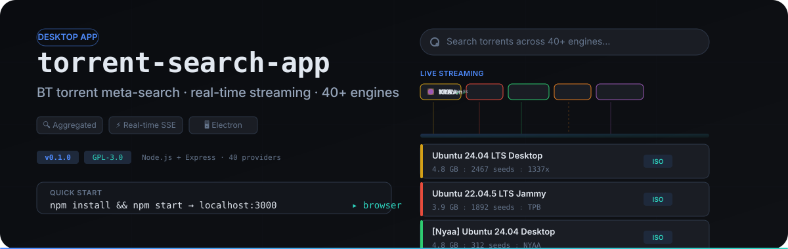

# BT 聚合搜索 · Torrent Meta-Search

<p align="center">
  
</p>

一个 Windows 桌面应用。输入一个关键词，**磁力 / 在线影视 / 网盘**三种来源并行搜，
结果分三栏各自呈现、互不混流：

| 模式 | 做什么 | 结果怎么用 |
|---|---|---|
| **磁力** | 28 家 BT 站并发检索，跨站去重合并 | 复制磁力 / 一键推送到下载器 |
| **视频** | 5 家在线影视站的搜索结果 | 点「打开网页」用系统浏览器看 |
| **网盘** | 接 PanSou，搜夸克 / 百度 / 阿里 / UC / 115 / PikPak… | 打开链接 + 自动复制提取码 |

主线是 **Rust**（单文件、零运行时依赖），`main` 上同时保留 **Node/Electron** 实现作对照。

> ⚠️ **本项目由 AI 辅助生成**，多引擎并行聚合的思路参考
> [prajwalch/TorrentSearch](https://github.com/prajwalch/TorrentSearch)（Kotlin/Android）。
> 代码可供学习、修改与再分发，但**不保证完整性与安全性**，使用前请自行审阅。

## 下载哪个？

三种 Windows 产物都在 [Releases](https://github.com/NoNameLeGo/torrent-search-app/releases)，
**引擎数量并不相同**：

| 产物 | 是什么 | 引擎 | 适合 |
|---|---|---|---|
| **`BT-Search-Rust-*.exe`** | **Rust 主线**：单文件、零运行时依赖、19 MB | **28 家 BT + 5 家视频 + PanSou 网盘** | 推荐：体积小、启动快、三模式 |
| `BT-Search-Electron-Setup-*.exe` | Node 后端 + Electron 壳（自带 Chromium） | **40 家 BT** + Torznab | 要最多 BT 引擎、收藏 / 历史 / 无限滚动 |
| `BT-Search-Tauri-Setup-*.exe` | 同一套 Node 后端 + 系统 WebView2 | 40 家 BT + Torznab | 想要更小体积的 Node 版 |

逐项差异见 [`docs/RELEASE_ARTIFACTS.md`](./docs/RELEASE_ARTIFACTS.md)。

## Rust 版（`main` 主线）

Windows 原生桌面应用：单文件、零运行时依赖、启动快、内存低。

### 实测指标（v0.4.0-beta，本机 2026-10-26 实测）

| 项 | 值 | 判据 |
|---|---|---|
| 单文件体积 | **19.1 MB**（20,018,688 B） | < 25 MB ✅ |
| 冷启动（同路径第 2 次起） | **0.76 – 0.81 s** | < 1 s ✅ |
| 首次运行（含 Defender 首扫） | 1.1 – 1.6 s | ⚠️ 超 1 s，属系统首次扫描 |
| 空闲内存（任务管理器口径） | **43.8 MB**（工作集 81.6 MB） | < 100 MB ✅ |
| 运行时依赖 | 导入表 24 个 DLL，**全是 Windows 系统 DLL** | 无 vcruntime140 / msvcp140 / ucrt ✅ |

"零运行时依赖"的机器证据：`release.yml` 用 `-C target-feature=+crt-static` 静态链 CRT，
`rust-size.yml` 断言产物不含 MSVC 运行时 DLL。⚠️ 正式判据（干净 Windows 双击）仍需人工在虚拟机上走一次。

### 能力

| | 能力 |
|---|---|
| 🔍 | **28 家 BT 引擎**并发（25 家与 Node 版对齐 + 3 家 Rust 独有），每站独立超时，状态条逐个显示 ✓/✕/耗时 |
| 🎬 | **5 家在线影视**（APP影院、独播库、嘀嗒、追影、宅男）：搜到条目后打开原站，不内嵌播放器 |
| ☁️ | **网盘（PanSou）**：夸克 / 百度 / 阿里 / UC / 115 / PikPak… 打开链接 + 自动复制提取码 |
| 🏷️ | 排序（做种 / 相关度 / 体积 / 日期）、分类筛选、关键词高亮、分页、站点开关 |
| 🎛️ | **Torznab 索引器**（Jackett / Prowlarr / \*arr），界面里填地址与 API key 即可 |
| ⬇️ | 四种下载器推送：qBittorrent / Transmission / aria2·Motrix / Gopeed；批量勾选推送、复制磁力、**导出 CSV**（写到 `selection.csv`） |
| 🩺 | **失败说得清**：区分"网络层不通"与"站点层拒绝"；连续空手的引擎打 ⚠（`--health` 看历史） |

**还差什么**：BT 引擎 28 家（Node 版 40 家），剩下 15 家多数两边都不通或已停摆
（分档见 `AGENTS.md`「受阻引擎清单」）；无 `t=caps` 探测、无缓存、无收藏 / 搜索历史；
网盘依赖外部 PanSou 服务，App 不内置也不托管它。

**架构**：核心是**库**（进程内直调，无 HTTP、无 SSE），UI 是 Slint；与 Node 版逐字段差分对齐
（24 家 × 15 字段，0 处未豁免差异）。细节见 [`docs/ROADMAP.md`](./docs/ROADMAP.md)、[`AGENTS.md`](./AGENTS.md)。

## 快速上手

**磁力 / 视频**：下载 `BT-Search-Rust-*.exe` 双击即可，无需安装、无需运行库。

**网盘**需要先有一个 PanSou 服务（App 只当客户端）：

```bash
docker run -d --name pansou -p 8888:8888 ghcr.io/fish2018/pansou:latest
```

然后在「设置 → 网盘」确认地址（默认 `http://127.0.0.1:8888`，开了认证就填 token），
切到「网盘」tab 搜索。服务没起来时只有网盘 tab 不可用，磁力与视频不受影响。

**下载器 / 索引器**都在界面里配，落盘在 `%APPDATA%\bt-search\`
（`config.json` / `indexers.json` / `pansou.json`）。

## Node 版（对照实现，功能最全）

`server.js`（Express）+ 原生 JS 前端，被两个桌面壳复用：**Electron**（自带 Chromium）与
**Tauri**（复用系统 WebView2）。所有抓取在本地后端完成，天然规避浏览器 CORS。

| | 能力 |
|---|---|
| 🔍 | **40 家引擎** + 离线 `demo` + Torznab 自定义索引器，8 路并发 |
| ⚡ | SSE 实时流：逐引擎推送状态与结果，慢站不拖累快站；按 infoHash 跨站去重 |
| 📚 | 搜索历史 & 收藏（跨会话）、详情预览（海报 / 描述 / 多站外链）、无限滚动 |
| ⌨️ | 批量推送 / 批量复制 / 导出 CSV、快捷键（Ctrl+K / Ctrl+D）、亮暗主题、移动端响应式 |

```bash
npm install
npm run electron     # 桌面窗口（自动选空闲端口）
npm start            # 或 node server.js → http://localhost:3000
```

> 本仓库**不在本机编译任何东西** —— 编译与打包全部走 GitHub Actions，产物从 Releases 下载。

分层、provider 契约、两个壳的差异见 [`CLAUDE.md`](./CLAUDE.md)。

## 说明与边界

- **只做搜索聚合**，不托管、不分发任何版权内容。第三方站点可能因区域 / 网络被屏蔽；
  抓取依赖公开页面结构，站点改版就要更新对应 provider。
- **凭据是明文存储的**：下载器密码 / token 在 `config.json`，Torznab API key 在 `indexers.json`，
  PanSou token 在 `pansou.json`（都在 `%APPDATA%\bt-search\`）。写在这里是为了**别让人以为它加密了**。
- 只支持 **Windows**（代码里没写死平台相关的东西，但没有其他平台的构建与验证）。
- 若把 Node 版后端部署成公开服务，务必只绑 `127.0.0.1`，避免暴露代理端点。

## 许可证

**GNU General Public License v3.0**，完整文本见 [LICENSE](./LICENSE)。

> 选 GPL-3.0 而非 AGPL-3.0：本项目是本地运行的桌面应用，不提供公开网络服务。
> 若你要把它部署成公开的在线搜索服务，建议改用 AGPL-3.0。
